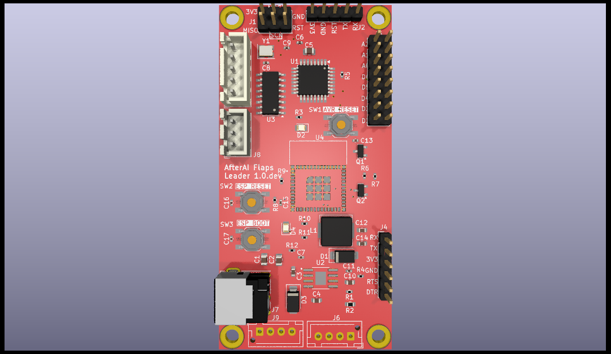
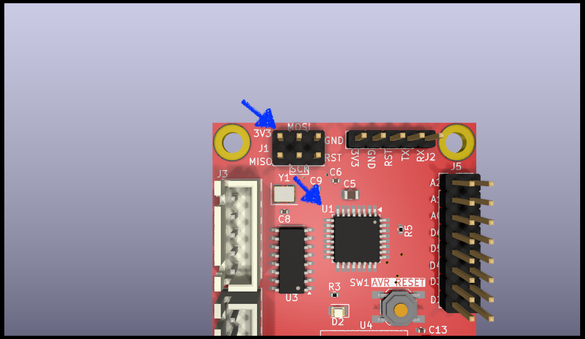
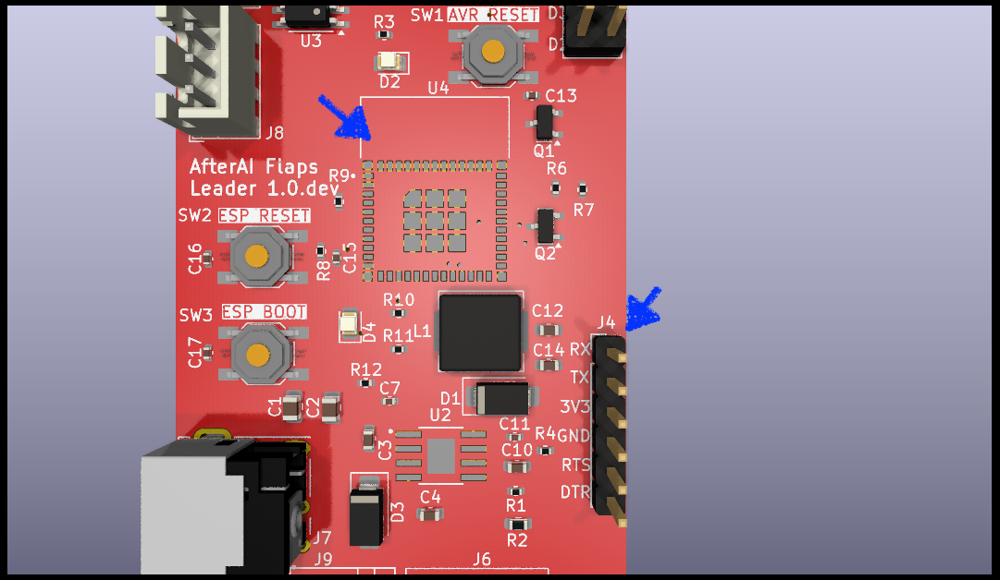
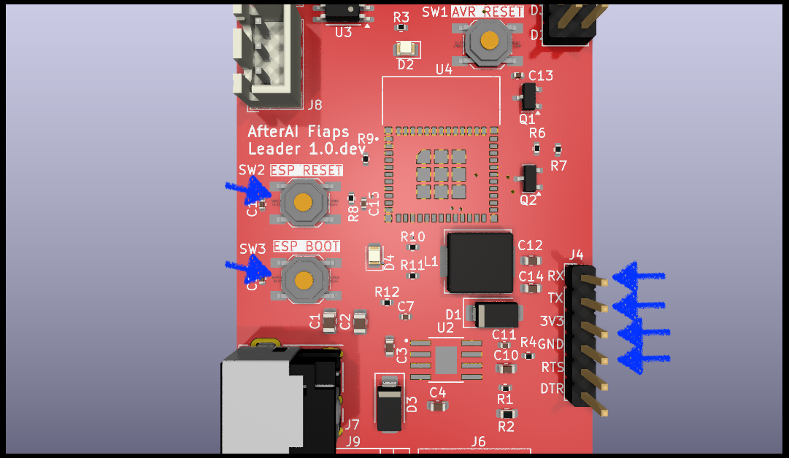
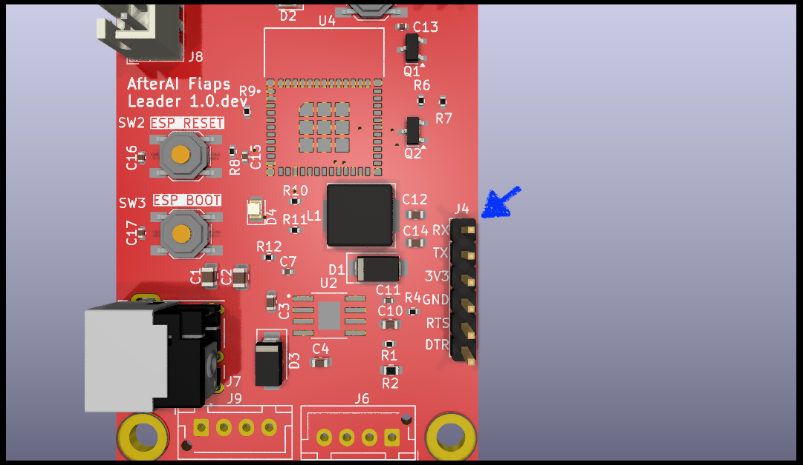

# How to Upload Program to AfterAI Flaps Leader

## U1: ATmega328P-A (AVR Chip)

In order to correctly write a program, you need to set fuse values as well as uploading the hex file.

### Interface

Use J1 to program U1. J1 is a pin header of ISP pins.

 

### Step 1: Writing Fuse Values

> [!NOTE] DO NOT SKIP
>
> If you do not set fuse values correctly, U1 will not run at all!! 

| Fuse     | Value |
| -------- | ----- |
| Low      | FF    |
| High     | DE    |
| Extended | FF    |

See [Explanation about Fuse Values of ATmega328P on AfterAI Flaps](explanation-about-fuse-values-of-atmega328p-on-afterai-flaps.md).

### Step 2: Upload Hex File

Upload `AVR.ino.with_bootloader.hex` to the flash memory of U1.

## U4: ESP32-C3-MINI-1 (ESP Chip)

You can program U4 in two methods, Basic Method and Advanced Method. You can follow whichever method.

### Interface

Use J4 to program U4. J4 is a pin header of serial communication pins.

### Basic Method: Push Buttons and Use 4 pins of J4

In this method of uploading a program, you will use two push buttons and 4 pins of J4 as illustrated in the following picture.

#### Step 1: Connect Cables

| J4  | Programmer |
| --- | ---------- |
| RX  | TX         |
| TX  | RX         |
| 3V3 | 3V3        |
| GND | GND        |

#### Step 2: Start U4 in Join Download Boot Mode

Performing the following button operations will start U4 in Join Download Boot mode.

| Step | SW 2 ESP RESET | SW3 ESP BOOT |
| ---- | -------------- | ------------ |
| 1    | Pushed         | Released     |
| 2    | Pushed         | Pushed       |
| 3    | Released       | Pushed       |
| 4    | Released       | Released     |

#### Step 3: Upload Files

Upload the files to the corresponding memory addresses.

| Address  | File                       |
| -------- | -------------------------- |
| 0x0      | ESP.ino.bootloader.bin     |
| 0x8000   | custom_partition_table.bin |
| 0x10000  | ESP.ino.bin                |
| 0x180000 | ESPLittleFs.bin            |

### Advanced Method: Use 6 pins of J4

In this method, you will not use any buttons. You just connect all of the pins of J6 to your programmer and upload.
You need a programmer that has not only TX, RX, 3V3, and GND pins, but also RTS and DTR. I have tested with DSD TECH's SH-U09C5 (USB type-A) and SH-U09B3 (USB type-C.)

#### Step 1: Connect Cables

| J4  | Programmer |
| --- | ---------- |
| RX  | TX         |
| TX  | RX         |
| 3V3 | 3V3        |
| GND | GND        |
| RTS | RTS        |
| DTR | DTR        |

#### Step 2: Upload Files

This step is the same as [Basic Method's Step 3: Upload Files](#step-3-upload-files).